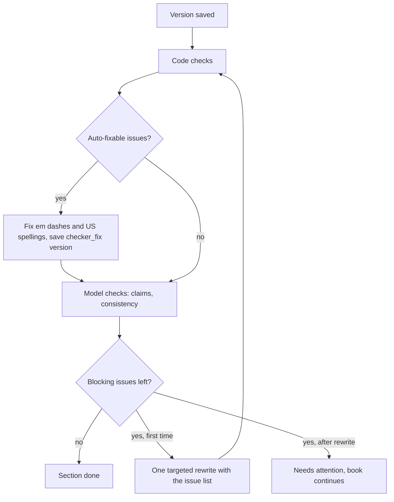

# 04 AI pipeline

Nine stages, one Node server, one OpenRouter key. Each stage has its own model choice, prompt files, output schema and guardrails. Prompts live in `prompts/` and are indexed in `docs/book-production/PROMPTS.md`; default models and fallbacks live in `config/models.defaults.json`. This file says what each stage takes in, what it must return and how the app checks it.

## Stages at a glance

| # | Stage (role) | Stage keys | Default tier | Prompt folder |
|---|---|---|---|---|
| 1 | Researcher | `research` | search | `prompts/research/` |
| 2 | Title strategist | `titles` | mid | `prompts/titles/` |
| 3 | Blueprint architect | `blueprint` | top | `prompts/blueprint/` |
| 4 | Chapter writer | `writing`, then `summarise` | mid, small | `prompts/writing/`, `prompts/checks/` |
| 5 | Checkers | `checks` plus code | small | `prompts/checks/` |
| 6 | Editor passes | `editing` | mid | `prompts/editing/` |
| 7 | Matter and metadata writer | `matter_metadata` | mid | `prompts/matter/` |
| 8 | Cover director | `cover_brief`, then `cover_image` | mid, image | `prompts/cover/` |
| 9 | Marketing writer | `marketing` | mid | `prompts/marketing/` |

Tiers: **top** (strongest Claude model), **mid** (mid Claude model), **small** (small fast model), **search** (Gemini model with web search), **image** (Gemini image model, default `google/gemini-2.5-flash-image`). Exact slugs and fallback lists are in `config/models.defaults.json` and must be checked against `GET /api/v1/models` before phase 2. The owner can change any stage per workspace, profile or book (profile models, project settings.models and workspace models.overrides, D-019).

### Three kinds of stage name

The word "stage" means three different things in the code. Keep them apart.

- **Book stage** (`projects.stage`, `apps/server/src/repos/books.ts:9`): where a book is in production, forward only: `idea`, `research`, `titles`, `blueprint`, `writing`, `editor`, `cover`, `export`, `marketing`. Choosing a title moves the book to `blueprint`; once writing is complete (every enabled section the AI or the owner writes has a current version, D-048) it moves to `editor`.
- **Model stage** (the keys of `stages` in `config/models.defaults.json`, and each prompt's front matter `stage`): which model, max tokens and temperature answer: `research`, `titles`, `blueprint`, `writing`, `summarise`, `checks`, `editing`, `matter_metadata`, `cover_brief`, `cover_image`, `marketing`. This is what the owner changes in Settings.
- **Job stage** (`AI_STAGES` in `apps/server/src/ports/ai.ts:11`): which server job runs, mapped to a model stage by `STAGE_TO_CONFIG` in `apps/server/src/jobs/runner.ts`. `blueprint_part` uses `blueprint`; `weave` (`writing.weave-note`, `writing.expand-note`) and `picture_story` use `writing`; `editing` (the three passes and `writing.rewrite-selection`) and `claim_fix` (`editing.claim-fix`) use `editing`; `scene_prompts` and `character_reference` use `cover_brief`.

The book stage records progress; it does not choose the model. Marketing is the one AI step gated on progress (stage 9 below).

The BOOK.md roles map here: Research AI is stage 1, Publisher AI stages 2 and 3, Story AI stage 4, Editor, Copy Editor and Proofreader stages 5 and 6, Amazon KDP AI stage 7, Cover Designer and Typography AI stage 8, Marketing AI stage 9.

## Stage contracts

Every structured output is validated twice: by the task's zod schema in `packages/ai/src/stages/outputs.ts` (the prompt's own fields), then by the server's stage schema in `apps/server/src/ports/ai.ts` after the adapter maps the fields. Field lists below are the server contract.

### 1 Researcher

- **In:** idea, owner notes, audience hint, profile summary (pen name, credentials, voice characteristics), template.
- **Out:** `audience` (who, situation, level), `problems[]`, `angles[]` (3 to 6, each with why), `competing_themes[]`, `gaps[]`, `keyword_ideas[]` (10 to 20), `notes`. Sources are not part of the schema: the app reads them from `url_citation` annotations only.
- **Fallback:** another search-capable model. Never runs without web search.

### 2 Title strategist

- **In:** idea, chosen research output, profile summary, house style.
- **Out:** `directions[5]` (`key`, `label`, `angle`, `audience`, `promise`), `options[10]` (`title`, `subtitle`, `direction_key`).
- **App checks:** combined length under 200 characters (FACTS 5.4), British spelling, banned phrases, no quality claims or time-sensitive words (FACTS 5.1 advice), no duplicates.

### 3 Blueprint architect

- **In:** chosen title and subtitle, research output, ticked sources, profile voice DNA, template (sections, word range, chapter count), house style.
- **Out:** `title`, `subtitle`, `summary` (200 to 500 words), `audience`, `usps[3..5]`, `tone_notes`, `hook_style` (`quote`, `question`, `scene`), `parts[]` (`number`, `title`), `chapters[]` (`number`, `title`, `part`, `subheadings[3..]`, `summary` 200 to 300 words, `word_target`, `key_points[]`, `takeaways` bool, `bridge_note`), `front` (`dedication`, `acknowledgements_notes`, `introduction` {summary, word_target}, `preface` {on, summary}, `epigraph` {on, text, attribution}), `back` (`conclusion` {summary, word_target}, `appendix`, `resources`, `glossary`, `references` on or off), `back_blurb`, `description_draft`, `categories[3]`, `keywords[7]`.
- **Blueprint blurb:** `back_blurb` here is a planning draft (the prompt's `backCoverBlurb`, 120 to 200 words, written before any chapter exists). It is kept with the blueprint and is the fallback for the pack only; see the matter blurb in stage 7.
- **Part regeneration:** the same prompt with a `part` input (`summary`, `chapter:<n>`, `chapters`, `front`, `back`, `listing`) and the rest of the blueprint as fixed context; returns only that part.
- **Epigraph rule:** text must be supplied by the owner or be public domain with a known author the owner confirms. The model may suggest "add your own epigraph" but never writes a quotation and attributes it.

### 4 Chapter writer

- **In:** see context packing below.
- **Out:** streamed Markdown in the Volume dialect (`docs/book-production/EXPORT-SPEC.md`): one `#` heading, the opening hook, `##` subheadings from the blueprint, flowing first-person prose, `::: takeaways` when on, a closing bridge.
- **Then `summarise`** (small model, JSON): `summary` (up to 120 words), `ledger[]` (`kind`, `key`, `detail`) for examples, anecdotes, people, places, metaphors, phrases, promises and terms used. Saved to `section_versions.summary` and `story_ledger`. From prompt v6 a front or back matter page (glossary, conclusion, review request, about the author) may have a 1 to 3 sentence summary and 0 to 6 key points.
- **Retry before a missing-step flag (21 October 2026):** when the summary or the claims and consistency check fails (a cut-off or invalid answer, a refusal), the writer runs it once more on the stage's model before it raises `summary_missing` or `checks_missing`. The runner names no fallback model here, so none is switched in; an unavailable model is not asked twice.
- **Book-type rules (21 October 2026):** writing v7 (chapter, introduction, conclusion, back matter) and `writing.extend-section` v5 get the book type's `genreRules.mustHaves` and `avoid` as plain text in `{{bookTypeRules}}` (`bookTypeRulesText` in `apps/server/src/config/book-structure.ts`, filled in by the adapter from `{{template}}`), plus a clean draft rules block: filled-in examples, no invented brands or case-study people, no guarantees, no unsourced statistics and the humanizer rules.
- **Writing samples (21 October 2026):** up to two profile samples of kind `sounds_like` or `writing_sample` (sounds-like first), each cut to its first 600 words at a paragraph end, go to the AI layer as voice DNA `soundsLike` and reach the writer as `{{profile.voiceSample}}`. A profile with no samples sends exactly what it sent before.

### 5 Checkers

Code first, then a small model for what code cannot judge. See "Checker gate" below.
- **Model checks out:** `claims[]` (`sentence`, `category`, `check_needed`, `start`, `end`), `consistency[]` (`issue`, `chapters[]`, `excerpt`).

### 6 Editor passes

- **Passes:** `structure` (does the chapter keep its blueprint promise, order, gaps, repeats across the book), `line` (British English line edit, shorter sentences, less filler, voice kept), `voice` (match the profile samples).
- **Out:** `suggestions[]` (`original`, `proposed`, `reason`, `start`, `end`). Never a full rewritten chapter.
- **Selection rewrite** (`writing.rewrite-selection`, `POST /sections/:id/rewrite-selection`): runs on the `editing` model (prompt v5 says so; earlier versions said `writing`). It returns one proposal (`text`, `changeNote`, `newClaims`); nothing is saved until the owner saves a version.
- **Claim fixes** (`editing.claim-fix`, `POST /books/:id/claims/:claimId/suggest`): the server's `claim_fix` job, on the `editing` model. It takes one sentence from the claims-to-verify report with its whole paragraph, the sentences either side, up to 800 characters either side, the chapter title, the author's voice, the book's tone and the house style rules, the owner's optional instruction, the profile facts and the ticked research sources, and returns three options (`text`, `approach`: soften, generalise, attribute, reframe or remove, `rationale`, `needsSource`). Zero invention: the prompt forbids new figures, studies, quotes, names, links or sources, and code then drops any option that cites a marker the book does not have, carries a link, holds a number found in neither the sentence nor a cited source, or adds an amount in words ("one in five", "half of") or a house-style guardrail pattern (according to, studies show, award words) the sentence did not have. Code also drops an option that is a near-duplicate of one already kept, or that repeats the sentence before or after it (word overlap of 0.8 or more). The prompt asks each option to keep the paragraph's meaning, tense, person, voice and subject, follow on from its neighbours and be no longer than the sentence. An AI attribution never marks a claim verified (D-052). Nothing is saved until the owner applies one (`/apply`), which saves a version and reruns the code checks. One call, priced before it is queued.
- **Notes** (`writing.weave-note`, `writing.expand-note`): the server's `weave` job, on the `writing` model. Weave works a note into the prose; expand turns it into a new `##` subsection of 2 to 4 paragraphs.
- **Memory:** an accepted suggestion can be saved to `profile_memory` (owner ticks "remember this").

### 7 Matter and metadata writer

- **Model stage `matter_metadata`, three prompts:** `matter.amazon-description`, `matter.keywords-categories`, `matter.back-cover` (the adapter runs them in turn and merges the answers).
- **When it runs (19 October 2026):** as the `listing` job, the last child of `write_book` (after every section it writes), and again from `POST /books/:id/listing` once writing is complete. It sends the approved blueprint, the written chapters' summaries, ticked sources, the dated-prices check and the profile. The answer is house-style fixed (keywords and categories left alone) and saved to `listings` (`description_html`, `back_blurb`, `short_bio`, `categories`, `keywords`). Before this, no job called the stage, so the listing came only from the blueprint drafts. When `write_book` has no section left to write it queues no listing job; the owner then writes the listing with `POST /books/:id/listing` (one at a time: 409 `conflict` while one is queued or running). A whole-book writing estimate (`POST /books/:id/estimate` with `stage: writing` and no `sectionIds`) builds the matter input with the same helper as the job (`apps/server/src/jobs/listing-input.ts`) and includes its three prompts, so the owner sees the listing's cost before writing. The owner's own blueprint edits to the description, keywords, categories or blurb always win: the job never overwrites them (`listings.source` is `ai:matter`) and the pack uses the owner's text.
- **In:** approved blueprint, chapter summaries, profile templates and links, published books under the pen name.
- **Out (server contract):** `description_html` (allowed tags only: `b`, `i`, `u`, `br`, `p`, `h4` to `h6`, `ol`, `ul`, `li`, FACTS 10.14) and `description_text`, `keywords[7]` with `keyword_reasons`, `categories[3]`, `back_blurb`, `short_bio` (the profile short bio, or the full bio condensed to 60 words or fewer with only its facts, flagged for the owner), `spine_text`. The schema also carries `dedication`, `acknowledgements`, `review_request` and `newsletter_line`, but this stage leaves them empty: those pages are written by `writing.front-matter` and `writing.back-matter` on the `writing` model.
- **Matter blurb:** `back_blurb` here is the back-cover blurb for the finished book: `matter.back-cover` returns a one-line headline and a body of 120 to 200 words (v6), which the adapter joins with a blank line. One range everywhere: the blueprint `backCoverBlurb`, the matter blurb and the template's `back-cover-blurb` limit are all 120 to 200 words.
- **Which listing the pack uses (D-049):** the matter stage's blurb, Amazon description, keywords and categories; for each one the matter stage has not written, the blueprint draft (`back_blurb`, `description_draft`, `keywords`, `categories`). The pack writes the blurb to `listing/back-cover-blurb.txt`, with the short bio beside it, and the paperback wrap prints the same blurb. So the listing prompts are `matter.back-cover` and `matter.amazon-description`; the blueprint prompts' listing drafts (and `blueprint.regenerate-part` for the `listing` part) are planning drafts and the fallback only.
- **Written by code, never by the model:** title page, copyright page (from templates), contents, about the author (profile bio verbatim), also by, the AI disclosure note.
- **App checks:** description 4,000 characters or fewer including tags (FACTS 5.3), exactly 7 keywords (FACTS 5.1) and 3 categories (FACTS 5.2), no banned keyword words (brand names, "Kindle Unlimited", "new", "on sale").

### 8 Cover director

- **`cover_brief` out:** `brief` (mood, audience, symbols to use and avoid, palette, composition with space for title), `concepts[3..4]` (`name`, `image_prompt`, `why`).
- **`cover_image`:** one image per concept, portrait 2:3 (the images endpoint rejects 5:8; the export fits the art to 1600 x 2560), no text, no letters, no logos, no real people's faces. Returned as base64, stored as `assets` with `ai_generated = 1`.
- Typography is set by `packages/export`, never by the model.

### 9 Marketing writer

- **Gate (D-049):** marketing opens only when writing is complete, the same predicate that moves the book to `editor` (D-048). The server computes it and returns `writingComplete` on the book; the web app reads that field and nothing else. Scripts quote the finished chapters, so they never run on a half-written book.
- **Counts:** from the book template's `marketing` defaults (`count` on `tiktok-scripts` and `instagram-captions`), 5 TikTok scripts and 5 Instagram posts unless the template says otherwise. The server passes them as `tiktokCount` and `instagramCount`; the prompts receive them as `{{count}}` and hard-code no number. The mock provider returns as many items as `count` asks for.
- **Out:** `tiktok[]` (`hook`, `beats[]`, `on_screen[]`, `cta`, `seconds`), `instagram[]` (`caption`, `hashtags[]` up to 10, `cta`), `email` (`subjects[3]`, `preview`, `body`).
- **Distinct items (19 October 2026):** `marketing.tiktok-scripts.v6` and `marketing.instagram-captions.v6` ask for exactly `{{count}}` items, each with its own angle, opening and body, and a time range on every TikTok beat. The adapter drops an item whose hook or first line, or whose body, repeats an earlier one (case and punctuation folded) and, when that leaves fewer than asked, asks once more for the missing number with `{{variety.avoid}}` listing the openings so far. The marketing job also saves each post once. Regenerating one item sends the owner's instruction as `{{variety.instruction}}` and the book's other openings of that kind as `{{variety.avoid}}`. A beat with no time is saved as its words alone, never ", : words".
- **Rules:** no invented reviews, ratings, rankings, awards or sales figures; no review incentives (FACTS 10.6, 10.7); quotes only from the book itself.

## Context packing

`packages/ai/context` builds each request from labelled blocks, in this order, and trims from the bottom of the priority list until it fits 60% of the model's context length (the rest is left for output).

| Priority | Block | Writing stage contents |
|---|---|---|
| 1 | System rules | House style, guardrails, output format |
| 2 | Voice | Profile voice DNA, up to 2 sounds-like samples, 1 not-like sample, active memory items |
| 3 | This task | Chapter plan from the blueprint: title, subheadings, summary, key points, word target, hook style, takeaways flag |
| 4 | Book frame | Title, subtitle, book summary, audience, full contents (titles only) |
| 5 | Continuity | Summaries of every earlier chapter (up to 120 words each), last 300 words of the previous chapter, bridge note |
| 6 | Ledger | Every `story_ledger` entry so far, as "already used, do not repeat" |
| 7 | Facts allowed | Ticked research sources (title, url, excerpt) and owner-entered facts. Nothing else may be cited |

Trimming drops excerpts first, then older chapter summaries are shortened to 40 words, then samples drop to one. Blocks 1 to 3 are never trimmed; if they do not fit, the job stops with a message to pick a larger-context model.

## Guardrails

Enforced in prompts and, more importantly, in code after every response.

- **Never invent:** ISBNs, statistics, percentages, studies, surveys, quotes with attribution, testimonials, reviews, awards, rankings, credentials or sources. Prompts say so; checkers catch patterns (ISBN-like digit runs, `%`, "studies show", "research shows", "according to", "a survey", "award-winning", "bestselling", quotation marks followed by a name, URLs not in ticked sources).
- **Claims report categories:** `medical`, `clinical`, `legal`, `safety`, `statistical`, `financial`, `other_fact`. Every such statement goes to `claims` with chapter and sentence. Statistics with no ticked source are blocked, not just listed.
- **About the author** is the profile bio verbatim, inserted by code.
- **AI disclosure** is set automatically: text `ai_generated` when any kept text came from the writer or matter stages; images `ai_generated` when any cover or interior image came from `cover_image` (FACTS 5.5).
- **Real people:** for a real-person profile, first-person stories about patients, clients or named individuals are written as composites without identifying details, and the illustrative line is offered on the copyright page.
- **No hidden AI claims:** the app writes in a natural human voice, but nothing in any prompt or output tries to hide AI use from KDP or readers.
- **Prompt injection:** research excerpts and owner text go in fenced, labelled data blocks; prompts say that text inside them is data, not instructions.

## Checker gate

Runs after every AI write and every owner save.

- **Blocking:** em dash, banned phrase, invented-content pattern, unsourced statistic, missing subheadings (fewer than 3 in non-fiction), word count outside plus or minus 15% of target, missing hook or bridge.
- **Warning:** repetition, heading case, consistency notes, open claims.
- **Auto-fix rules (planned, not wired):** `config/house-style.json` marks em and en dashes `autofix: true` and US spellings `autofix: "suggest"`, and `packages/core` has `fixDashes`, but no server job calls it and no `checker_fix` version is ever saved. Today em dashes and US spellings are reported as findings; in the editor the owner applies them one by one from the issue list (`apps/web/src/features/editor/textTools.ts`). The flowchart's auto-fix box describes the intended design.
- **The rewrite that does run:** inside `@volume/ai`, when an answer uses banned phrases (any task with full guardrails, except internal notes such as research) or a written section has too many scaffolding openers, one automatic style rewrite on the same model (`system.style-rewrite`) is sent before the answer is returned. There is no second, issue-list rewrite after the server's code checks: a section with blocking findings is saved as `needs_attention` and the book continues.

## Live-run lessons (5 October 2026)

Two live books on the owner's key changed these rules. Code: `packages/ai` and `apps/server`.

- **Sampling settings.** `modelRules` in `config/models.defaults.json` leaves out temperature, top_p and top_k for models that reject them (Opus 4.7 and later, Sonnet 5 and later, and the `~anthropic/*-latest` aliases; Anthropic's Opus 5.5 migration guide). A 400 that names an unsupported parameter is retried once without it. OpenRouter's model list is not trusted for this.
- **Schema refusals.** When a provider refuses a structured-output schema (seen: Azure "compiled grammar is too large" on the blueprint), the call is retried with OpenRouter told to skip that provider, then with JSON by instruction and the schema in the repair prompt (`system/json-repair.v2`). The provider's own words reach the job message.
- **Cut-off answers.** `finish_reason` length (or a native max-tokens reason) raises `OutputTruncatedError`; one retry with twice the max tokens and low reasoning effort where supported, else a plain `output_truncated` error. Cut-off text is never repaired, parsed or saved. Stage max tokens were raised (writing 32k).
- **Spend on failures.** Known usage from completed internal calls is retained when a later call fails and counts against the book budget. A failed provider request may return no usage, so its actual charge cannot always be recovered.
- **Estimates.** Research and blueprint highs cover the full output allowance plus web searches; writing highs are twice the expected output from the section's word target, capped at max tokens.
- **Research sources.** A search that returns no sources is retried once with Exa. Google grounding redirects are resolved to real URLs (D-020).
- **Word targets.** The blueprint receives the book word target; the server rescales section targets when the plan is more than 10% off. A section under 85% of its target gets one extend pass (`writing.extend-section.v1`), kept only if longer; over 115% gets a warning.
- **Author facts.** Every reader-facing prompt gets a facts block built only from the profile and must not state anything else about the author. Acknowledgements thank only owner-given names; otherwise a placeholder blocks preflight.
- **Repetition.** Later writing calls receive the used-already ledger (terms defined, warnings given, stories, overused phrases); after each section the `@volume/core` repetition checker turns later repeats into editor suggestions.

Live run 3 ("Small Offer, Real Customers") added these rules. Code: `packages/core` (`checks.ts`, `repetition.ts`), `packages/export` (preflight), `packages/ai`, `apps/server`; prompts as listed in `docs/book-production/PROMPTS.md`.

- **Resources.** No ticked research source: Resources is saved as an owner placeholder (no AI call) and preflight blocks with "Resources needs sources: tick sources in Research". Resolved research sources are ticked for the book by default (unresolved redirects are not). The page lists every ticked source in order, from the model's description or the source title; junk entries are dropped (`writing.back-matter.v4`).
- **Template junk.** Preflight "No unfilled placeholders" and the per-section checks catch echo lines ("- x: x"), TBD and TODO, lorem ipsum, "[NEEDS ...]" brackets, "{placeholder}" braces and empty list items (`findTemplateJunk`).
- **Covers.** The final pack preflight blocks (`cover.files`) when there is no eBook cover and no paperback wrap; the single manuscript files still build and the Export screen still lets the owner build them.
- **Checks context.** `checks.consistency.v2` reads the profile facts block (bio included) instead of perspective and credentials, and judges each section only against its own plan (a front or back matter page sends its template rule as its plan, and its kind).
- **Glossary.** A deterministic post-step after writing merges entries with the same term or definition (keeping the longest term the book uses), drops terms the book text never uses and sorts the rest (`tidyGlossaryMarkdown`).
- **Dated prices.** Book types with `genreRules.datedPrices` (tech how-to, travel) send the writer "(checked <Month Year>)" from the write date; every currency amount with no month in its sentence is a section warning and a preflight item (`style.dated-prices`, a block when the book also promises dated prices). How to Use, the listing and matter prompts may promise dated prices only when `{{book.pricesCheck}}` starts with "passed", which needs every body section written.
- **Invented experience.** Writing prompts v4 forbid first-person experience, habits, history and conversations not in the profile facts; `checks.claims.v3` lists them as "personal" claims, and each open personal claim is a preflight warning.
- **Named firms.** Prompts never name a firm, product or person as a scam, regulated or listed unless a ticked source states it; `checks.claims.v3` type "named-entity-regulatory" becomes claim category `regulatory`, and each open one blocks preflight until verified or removed.
- **Unsourced price stamps and invented author scenes (19 October 2026).** The live acceptance run of 18 October 2026 found 16 invented prices stamped "(checked October 2026)" and scenes such as "The author set a personal ceiling of £8 a month". The writing prompts (`writing.chapter.v6`, `writing.chapter-workbook.v2`, `writing.introduction.v6`, `writing.extend-section.v4`, `writing.back-matter.v6`) now allow a price, figure or "checked" stamp only from a research source with its `[[S<n>]]` marker, and otherwise a clearly hypothetical "you" figure with no stamp; `writing.conclusion.v6` and `writing.front-matter.v6` have no sources and write no stamps. The author's experiences come only from the profile facts, and "the author" is never a character in a scene. Two code checks in `packages/ai/src/guardrails.ts` send hits to the claims report: `checked-stamp-unsourced` (a stamp with no known source marker in its sentence) and `author-anecdote` (the author narrated in the third person, or a first-person past experience whose sentence the profile facts and brief do not support). `author-anecdote` runs only when the caller passes `authorFacts` (the AI service does, from the profile facts block and the book idea or notes); fiction and picture-book tasks skip it. Follow-ups outside `packages/ai`: the core `style.dated-prices` warning still asks for a month on every currency amount, including hypothetical ones, and the server's save-time check (`apps/server/src/jobs/guardrails.ts`) does not pass `authorFacts` yet.
- **Blurbs that sell (19 October 2026).** `matter.back-cover.v7`, `matter.amazon-description.v6` and the blueprint listing drafts (`blueprint.blueprint.v6`, `blueprint.blueprint-workbook.v2`) sell the book to the reader (the problem, the promise, who it is for, what they get) and never describe the text itself (language, tone, style, composites). The blurb stays 120 to 200 words with no reviews, rankings or awards.
- **Continuity.** `checks.consistency.v2` returns `unknownReferences` (scenes, conversations or details no earlier summary or ledger entry holds), saved as consistency warnings.
- **Marketing.** The marketing stage gets the approved blueprint and each written section's summary with its key takeaways; marketing prompts v4 describe only what the written book teaches.
- **Claims noise.** `checks.claims.v3` skips lines that only tell a labelled composite story and keeps factual, legal, financial, safety, statistical and personal claims.
- **Claims scope (21 October 2026).** `checks.claims.v5` adds a "Do not list" block (hypothetical reader examples, invented illustrative businesses, people or products, example prompt and template text, general glossary definitions, the author's own advice and method steps, neutral product mentions). The server drops items the model rates `risk: "low"` with `harmIfWrong: false`, files no model claims for the `review_request`, `also_by` and `how_to_use` sections, keeps only medical, clinical and legal claims for a glossary, and records the text a claim was fixed or softened with in the claim's `location.replacement` so the next check does not file the fixed wording again.
- **Profile facts once.** Writers get `{{profile.factsUsedIn}}` (sections that already state the bio) and may state the background once in the body; the repetition checker (`findProfileReuse`) turns later restatements into editor suggestions.
- **Scaffolding openers.** A written section with more paragraph openers than `aiHabits.paragraphOpeners.maxPerSection` gets the one style rewrite naming them (`system.style-rewrite.v2`), in the same call as banned phrases; the rewrite is kept only if it reduces them.
- **Source titles.** `research.title-research.v2` returns a short title and URL per cited source; a citation whose title is only its domain takes that title (matched by URL, else by id). No page is fetched (D-020).
- **Blueprint estimate.** The blueprint and blueprint part high estimates carry a 1.35 margin (`HIGH_ESTIMATE_MARGIN`), after an actual $0.687 against a high of $0.651.
- **Job errors.** The web app shows `ai_credits` ("OpenRouter has no credit left. Top up at openrouter.ai, then retry.") and `output_truncated` in plain words wherever job errors appear; job children now carry `errorCode`.

## Retries and failures

| Failure | Action |
|---|---|
| Network, 5xx, 408, 429 | Retry with backoff (2 s, 10 s, 60 s, jitter, `Retry-After` wins), up to 3 attempts |
| Invalid JSON or schema mismatch | One repair request with the zod errors; then fail the call as `invalid_output` |
| Stream stops early | Discard partial text, retry the section |
| Model missing or 404 | Stop, offer the next fallback model to the owner (never silent). The failed job's result names the stage and the fallback; the screen shows "Use the Settings model and try again", which removes the withdrawn model from the book, pen name and workspace choices (`POST /books/:id/models/withdraw`) and reruns |
| Content refusal | Mark `needs_attention` with the refusal text; owner edits the plan or picks another model |

## Cost meter and budgets

- **Before a run:** estimate = input tokens (counted from the packed context) x input price + expected output tokens (word target x 1.4) x output price, with a high estimate at 1.5 times. Shown on every "Run" button that costs money.
- **During:** each `prompt_runs` row stores the cost reported by OpenRouter (or computed from the registry); `projects.cost_to_date_usd` and the job's `cost_usd` update and stream as `cost.update`.
- **Limits:** book budget (default from Settings), monthly workspace cap, warning at 80%. Each internal request, retry and repair checks remaining allowance; shared reservations protect overlapping jobs. A call estimated to exceed a limit is not sent; the job pauses as `paused_budget`. Estimates depend on model prices and returned usage.
- **Live test runs** need `LIVE_AI=1` and a run budget (`docs/06-quality/TEST-STRATEGY.md`).

## Prompt versioning

- Files: `prompts/<folder>/<name>.v<N>.md`, ids such as `writing.chapter`. Front matter: `id`, `version`, `stage`, `tier`, `inputs`, `output`, `derived_from`, `guardrails`.
- The loader picks the highest version. Changing a prompt means a new file; old versions stay so past runs can be explained.
- **Pinning (plumbed, not used):** `AiStageInput.promptVersion` and the `@volume/ai` `promptVersion` option can run an older version, and the adapter honours it on the primary call of a stage. Nothing sets it yet: there is no per-book pin in settings and no job passes one, so every run uses the latest version. Prompt change notes that say "books pinned to an older version keep using it" describe this capability, not a feature the owner can use today.
- Every `prompt_runs` row stores `prompt_id`, `prompt_version` and `prompt_hash`.
- Templates use named placeholders only (for example `{{chapter.title}}`); the loader fails if a placeholder has no value.

## Mock provider

- Implements the same `AiProvider` interface. Default in tests and whenever no key is set.
- Deterministic: answers come from fixtures in `packages/ai/test/fixtures/` (`<promptId>.json` or `<stage>/<promptId>.json`) chosen by prompt id and a hash of the inputs, with a generic valid fallback per schema.
- Streams in chunks with a short delay so progress UI and SSE can be tested.
- Fault injection by scenario name: `rate_limit`, `server_error`, `invalid_json`, `invalid_json_always`, `stream_cut`, `truncated`, `truncated_always`, `refusal`, `model_missing`, `slow`, `no_sources`.
- With no fixture, the sample answer built from the schema fills each top-level list to the task input's `count` (for example five TikTok scripts), so count handling is testable without fixtures.
- Reports a fixed fake cost so budget logic is tested without money.

## Humanizer wording, 6 October 2026

Latest prompt versions apply humanizer 3.0.0 principles within the existing task contracts. Writing guidance follows author samples and the subject, with optional scenes and chapter connections instead of a compulsory story/bridge formula. Editing preserves supported facts, exact source markers and protected lines; internal checks preserve evidence quotations. The voice prompt no longer suggests turning a factual explanation into an invented first-person memory.

This guidance lives in prompts/, with no machine-specific runtime skill dependency and no additional automatic AI call. Style repair still runs only on its existing banned-phrase/opening triggers. It remains a targeted repair, not a general new editing pass. House style and accurate AI disclosure remain in force. PromptLoader caches files when constructed; an already running server needs an owner-controlled restart to load the new files. No existing server was restarted during this change.

Mock verification confirms prompt selection, rendering and output contracts, not the literary quality of a live book. New live quality acceptance remains NOT TESTED. The earlier free-run failures are preserved in FREE-AI-VALIDATION-2026-10-06.md.
