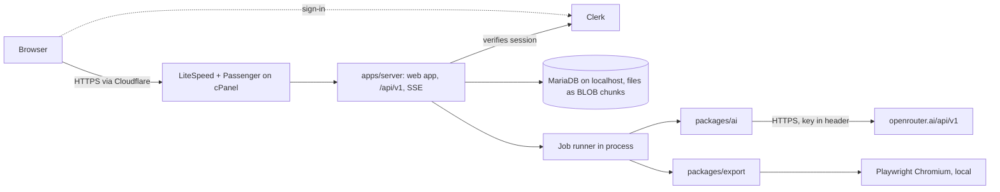

# 02 Architecture

One Node server and one web app on the owner’s macOS or Linux computer, in an npm workspaces monorepo, TypeScript strict throughout. The stack is fixed in `AGENTS.md`; changing it needs a `docs/08-change-management/DECISIONS.md` entry and the owner's OK.

## Monorepo

```
volume/
  AGENTS.md CLAUDE.md GEMINI.md README.md docs/08-change-management/DECISIONS.md CHANGELOG.md KNOWN-ISSUES.md
  package.json  tsconfig.base.json  .gitignore  .env.example  .editorconfig  .nvmrc
  .agent/       PROJECT.yml CURRENT-TASK.md HANDOFF.md
  .claude/      settings.json agents/ skills/ hooks/
  docs/         00-foundation/ ... 09-release/, book-production/, reference/, source-drafts/
  config/       kdp-rules/ models.defaults.json house-style.json book-templates/
  prompts/      research/ titles/ blueprint/ writing/ checks/ editing/ matter/ cover/ marketing/ children/
  apps/web/     src/app/ src/auth/ src/features/ src/site/ src/demo/ src/shell/ src/components/
  apps/server/
  packages/core/ packages/ai/ packages/export/ packages/ui/
  assets/fonts/  tests/  scripts/  qa/  data/ (root only, git-ignored)
```

| Folder | Purpose | Depends on | Phase |
|---|---|---|---|
| `.agent/` | Project card, current task, handoff log for any AI | | 0 |
| `.claude/` | Claude Code agents, skills, hooks (guards for `.env`, `data/`, house style) | | 0 |
| `docs/` | Specs. `source-drafts/` is the owner's original wording, not rules | | 0 |
| `config/kdp-rules/` | KDP facts as JSON with fact ID, value, source URL, date read | | 0 |
| `config/models.defaults.json` | Default OpenRouter model and fallbacks per stage | | 0 |
| `config/house-style.json` | Banned phrases, US to UK spelling map, punctuation rules | | 0 |
| `config/book-templates/` | Section lists, word targets and rules per template | | 0 |
| `prompts/` | Versioned prompt files per stage, indexed in `docs/book-production/PROMPTS.md` | | 0 |
| `apps/web` | Screens: Vite, React, React Router, Tailwind v4, motion/react, TanStack Query, TipTap | `packages/ui`, `packages/core` (types and pure helpers only) | 1 |
| `apps/web/src/site/` | Public pages for signed-out visitors on a hosted build (`PublicSite`): landing at `/`, How it works, branded sign-in. GSAP 3.15.0, Lenis 1.3.27 and adapted React Bits (MIT) for these pages only, in a lazy chunk (D-053, D-054) | `apps/web` | after 8 |
| `apps/server` | Fastify API under `/api/v1`, zod validation, Kysely (SQLite or MySQL, D-015, D-019), job queue, SSE, file storage, serves the built web app | `core`, `ai`, `export` | 1 |
| `packages/core` | Book model (sections, blocks), Markdown parser and writer, house-style rules, deterministic checkers, KDP maths, shared zod schemas. No network, no file system | | 1 |
| `packages/ai` | OpenRouter client, mock provider, model registry, prompt loader, context packer, guardrails, cost estimator. Server only | `core` | 2 |
| `packages/export` | Print PDF (Paged.js in Playwright Chromium, pdf-lib metadata), DOCX (`docx`), EPUB 3, TXT, MD, covers (Playwright plus sharp), preflight, zip pack | `core` | 1, 4, 5 |
| `packages/ui` | Design tokens and shared components from `../03-design/DESIGN-SYSTEM.md` | | 0 to 1 |
| `apps/web/src/demo/` | Phase 0 mock data, kept as the fallback when the server is off (the prototype moved into `apps/web` on 5 October 2026) | | 0 |
| `assets/fonts/` | OFL fonts and licence files; serif book fonts added in phase 1 | | 0 to 1 |
| `tests/` | `unit/`, `golden/`, `e2e/` (see `../06-quality/TEST-STRATEGY.md`) | | 1 |
| `scripts/` | `seed`, `backup`, `verify-env` (checks key names, never prints values) | | 1 |
| `data/` | SQLite database, project files, exports, backups. Never read by AI tools | | 1 |

Rule: `apps/web` never imports `packages/ai` or `packages/export`. A lint rule enforces it.

## Runtime picture



- Hosted (D-038): one Passenger Node.js app at https://volume.gakinz.com on Node 24.21. Fastify serves the built web app (static files, SPA fallback) and `/api` from one process; MariaDB on localhost holds everything, including files. Steps and settings: [deployment](../07-operations/DEPLOYMENT.md).
- Development: SQLite in `data/`, the Vite dev server on 127.0.0.1:5180 proxies `/api` to the server on 127.0.0.1:5181, no sign-in (`AUTH_MODE=local`).
- The server always binds to 127.0.0.1 (Passenger replaces the listen socket on the host). Setting names live in `.env.example` and `apps/server/src/config/env.ts`.

## Request flow

1. The browser calls `/api/v1/...` with JSON. TanStack Query caches reads and invalidates on mutation or on SSE events.
2. Fastify `onRequest` hooks: rate limit per visitor IP (`CF-Connecting-IP` behind Cloudflare), Host check (`ALLOWED_HOSTS`, default the `APP_ORIGIN` host; loopback in development), Origin check on writes, then for `/api` (not `/api/health`) the auth provider that attaches `ctx = { workspaceId, userId, role }`: Clerk in production (D-039), the owner stub in development.
3. Route handler validates params and body with zod schemas from `packages/core`.
4. Handler calls a service. Services take `ctx` first and only reach the database through repositories that add `workspace_id` to every query.
5. Short work (save a section, run deterministic checks, KDP maths) returns directly. Long work (any AI call, PDF, cover, pack, backup) creates a job and returns `202 { jobId }`.
6. The job runner picks the job up, emits events, writes results, and the browser sees them through SSE.

Errors use one shape: `{ error: { code, message, details? } }` with codes such as `validation_failed`, `not_found`, `budget_exceeded`, `model_unavailable`, `provider_error`, `conflict`. Messages are plain British English, safe to show.

## Job queue

SQLite-backed, in the same process, so it survives restarts without extra services.

- **Table:** `jobs` and `job_events` (`DATA-MODEL.md`).
- **Claiming:** the runner polls every 500 ms and is also woken by an in-memory signal when a job is added. It claims one job in a transaction: `status = 'queued' AND run_after <= now AND (depends_on_job_id IS NULL OR that job succeeded)`, ordered by priority then created time; it sets `status = 'running'`, `locked_at`, `lock_token`.
- **Concurrency:** 2 AI jobs at once across the workspace, plus 1 slot kept for quick on-screen jobs (cover concepts, AI edit passes, note weaving, selection rewrites, claim fixes; `QUICK_KINDS` in `jobs/runner.ts`), which are also claimed before bulk work (priority 10, others 100). So a book being written never holds up a cover concept for an hour. 1 export job, 1 backup. Chapter jobs in one book run in order, because each chapter needs the summaries and ledger from the ones before it (`depends_on_job_id`).
- **Parent and children:** `write_book` creates one `write_section` child per section. The parent's progress is the share of children done; it succeeds when all children succeed or are marked "needs attention".
- **Retries:** up to 3 attempts for network errors, 5xx, 408 and 429, with backoff of 2 s, 10 s and 60 s plus up to 20% jitter. A `Retry-After` header wins when present. Validation failures of AI output get one repair attempt inside the same attempt.
- **Heartbeat and resume:** a running job updates `locked_at` every 15 s. On start-up, jobs in `running` with `locked_at` older than 60 s go back to `queued` with the attempt count kept. A section job always restarts its section from the beginning; partial streamed text is discarded.
- **Budget:** before each AI call the runner estimates the cost; internal requests, retries and repairs also check remaining allowance, with shared reservations for concurrent jobs. If `spent + estimate` passes the book budget or monthly cap, the job moves to `paused_budget` and emits `budget.paused`. Raising the budget re-queues it.
- **Cancel:** sets `cancel_requested`; the runner aborts the HTTP request with an `AbortController` and marks the job `cancelled`.
- **Idempotency:** each job writes its result in one transaction at the end, so a job that dies half way leaves no half-saved version.

## Live progress (SSE)

- `GET /api/v1/events?projectId=<id>` returns `text/event-stream`. Without `projectId` it streams workspace-level events (Library cards, budgets).
- Each event has `id` (the `job_events` ULID), `event` (type) and `data` (JSON).
- Types: `job.status`, `job.progress`, `section.delta` (streamed text, throttled to every 250 ms, not stored), `section.saved`, `check.result`, `claim.added`, `cost.update`, `budget.paused`, `export.ready`.
- On reconnect the browser sends `Last-Event-ID`; the server replays stored events after it. A `: ping` comment every 15 s keeps the stream open.
- `job_events` older than 30 days are pruned, except the final status of each job.

## OpenRouter integration

All AI goes through OpenRouter with one key, `OPENROUTER_API_KEY`, read from the server `.env`. Details below were **checked on openrouter.ai/docs 4 October 2026, re-verify before phase 2** (and image details before phase 4).

| Need | How |
|---|---|
| Text | `POST https://openrouter.ai/api/v1/chat/completions` through the official OpenAI SDK with `baseURL: "https://openrouter.ai/api/v1"`. Streaming for chapters. Structured JSON output (`response_format` with a JSON schema) where the model supports it, otherwise JSON by instruction plus zod validation |
| Usage and cost | Read `usage` (tokens and cost) from each response and store it in `prompt_runs`. If cost is missing, compute it from the registry prices |
| Web search | The chosen model with the `:online` suffix or the `web` plugin. Native search for Anthropic, Google and OpenAI models, Exa for others. Sources come only from `url_citation` annotations on the message (url, title, content, start and end index), never from text the model typed |
| Images | `POST https://openrouter.ai/api/v1/images`, base64 results, aspect ratio and resolution options. Failed-call cost may be unknown if the provider returns no usage. Default `google/gemini-2.5-flash-image`. Cover text is always set by the app |
| Models | `GET https://openrouter.ai/api/v1/models`: id, name, context length, input and output modalities, supported parameters, prices. Cached for 24 hours; "Refresh" in Settings |
| Key check | A key-status call that returns validity and limits, shown in Settings without the key |
| App name | Optional `HTTP-Referer` and `X-OpenRouter-Title` headers name Volume |

The client lives in `packages/ai` behind one interface, so the mock provider and OpenRouter are interchangeable:

```ts
interface AiProvider {
  chat(req: ChatRequest, signal?: AbortSignal): Promise<ChatResult>;
  stream(req: ChatRequest, signal?: AbortSignal): AsyncIterable<ChatDelta>;
  image(req: ImageRequest, signal?: AbortSignal): Promise<ImageResult>;
  listModels(): Promise<ModelInfo[]>;
  keyStatus(): Promise<KeyStatus>;
}
```

The provider is chosen at start-up: `mock` when no key is set or in tests, `openrouter` otherwise. Live calls in tests need `LIVE_AI=1` and a budget.

## Fallbacks

1. A call fails with a retryable error: retry as in the job queue.
2. Still failing, or the model is gone from the model list or returns 404: the job stops with `model_unavailable` and the next model in the stage's fallback list is **offered** to the owner (Writing screen and a notice). One click switches the model for this book and resumes.
3. The app never switches model silently. Every `prompt_runs` row records the model that actually answered.
4. Web search unavailable for the chosen model: research stops and asks for a search-capable model; it never runs research without search.

## Binding and public hosting

- Server listens on `127.0.0.1` only. No `0.0.0.0`. On the host, Passenger fronts it and Cloudflare fronts Passenger (the docroot `.htaccess` refuses requests without `CF-RAY`).
- Host header must be an allowed host (guards against DNS rebinding). Origin must match on every write. CORS is off. Security headers on every response; a Content Security Policy on pages; no stack traces in responses.
- No outside network calls except OpenRouter. Fonts, scripts and images are bundled. Checking research links on the open web is off unless the owner turns it on (see `KNOWN-ISSUES.md`).

## Multi-user readiness

- Every table except `workspaces` and `users` has `workspace_id`, indexed. Repositories refuse a query without it.
- IDs are ULIDs (sortable, safe to show, no counters to leak).
- On first start the server creates one workspace and one owner user. Locally the stub attaches them to every request. Hosted, Clerk sign-in maps an allowed Clerk user to a Volume user through `users.clerk_user_id` (the first one binds the owner); routes and services are unchanged because they already take `ctx`.
- Roles are `owner`, `editor` and `viewer`, stored on `memberships` (D-047). With the default `ACCOUNTS_MODE=owner-only`, only the allowlisted owner accounts can sign in. With `ACCOUNTS_MODE=invite`, the owner can invite editors and viewers by email (DEPLOYMENT.md, "Accounts setting").
- File paths include the workspace: `data/workspaces/<workspace_id>/projects/<project_id>/`.

## Storage layout

```
data/
  volume.sqlite (WAL mode, foreign keys on)
  workspaces/<workspace_id>/
    profiles/<profile_id>/   logo and brand assets
    projects/<project_id>/   imports/ assets/ covers/ exports/ packs/
  backups/                  timestamped SQLite snapshots (including file chunks)
  logs/                      server.log (rotated daily, keys and bodies redacted)
```

## Backups

- When enabled, the running server checks every 15 minutes and makes one snapshot per local day after the configured backup time (02:00 by default). Settings can also create one immediately.
- `VACUUM INTO` creates a consistent copy. Asset metadata and file chunks live in SQLite, so the snapshot contains the library and its files.
- Keep the newest 14 snapshots in `DATA_DIR/backups`. Weekly retention and a root backup CLI are not implemented.
- MySQL snapshots are managed by cPanel, not Volume.
- Restore instructions and verification: [BACKUP-RESTORE.md](../07-operations/BACKUP-RECOVERY.md).

## Configuration and secrets

- `.env` (git-ignored) holds `OPENROUTER_API_KEY` and local settings. `.env.example` lists names only. AI tools never read `.env` or `data/`.
- `config/` files are read at start-up and validated with zod; an invalid file stops the server with a clear message.
- KDP rules older than 90 days show a reminder in Settings and in preflight.

## GEE OS workspace

Current document routing is in [docs index](../README.md). Application workspaces and config/prompts/assets paths remain stable. The original plan is [historical](../08-change-management/plans/legacy-approved-plan.md); the approved [rebuild plan](../08-change-management/plans/GEE-OS-REBUILD.md) governs this migration. Setup/startup must work inside this repository without a parent workspace launcher.
