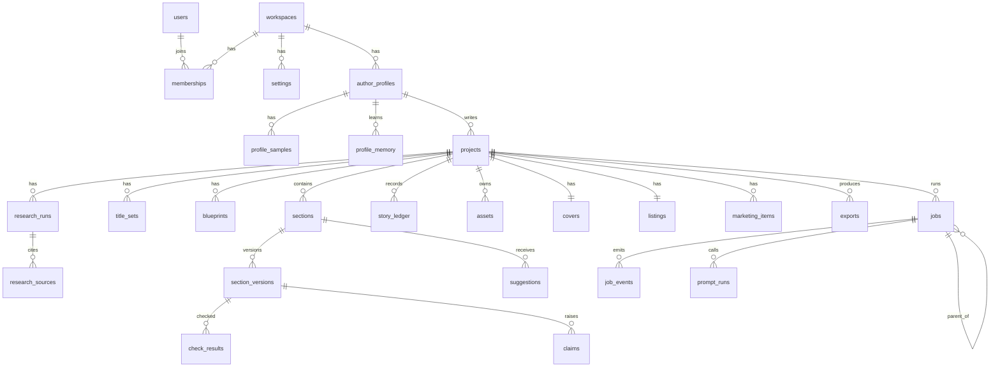

# 03 Data model

Kysely with two dialects (D-015, D-019): SQLite through better-sqlite3 locally and in tests, MySQL through mysql2 on the owner's cPanel. Migrations live in `apps/server/src/db/migrations/` and run on both. The table list as built is in `apps/server/README.md`. SQLite runs in WAL mode, `foreign_keys = ON`. Server input/JSON validation is defined alongside repositories and routes; AI stage schemas are in packages/ai/src/stages/. The descriptive tables below began as the design model; migrations and apps/server/src/db/schema.ts define the exact implemented columns.

## Conventions

- **IDs:** `id text primary key`, a ULID created in the app.
- **Tenancy:** every table except `workspaces` and `users` has `workspace_id text not null references workspaces(id)`, and every index that serves a list query starts with `workspace_id`.
- **Times:** `created_at` and `updated_at` are `integer` milliseconds since the epoch (BIGINT on MySQL), set by the repository layer.
- **Types:** `text`, `integer`, `real`; `json` means `text` holding JSON validated by zod; `bool` means `integer` 0 or 1; enums are `text` checked by zod and a `CHECK` constraint.
- **Money:** AI costs in US dollars as `real` (OpenRouter prices are in dollars). KDP prices and royalties in pounds as `integer` pence.
- **Deletes:** books and profiles are archived, not deleted. Child rows use `on delete cascade` from `projects` so a deliberate project delete (owner confirmed) removes everything under it.
- Columns `id`, `workspace_id`, `created_at`, `updated_at` are present on every table unless stated and are not repeated below.

## Accounts and settings

**workspaces** (no `workspace_id`): `name text not null`, `slug text unique not null`.

**users** (no `workspace_id`): `email text unique` (null for the local owner), `display_name text not null`, `auth_provider text` (`local` in v1), `password_hash text` (null until phase 8), `last_seen_at integer`.

**memberships**: `user_id text not null -> users`, `role text` (`owner`, `editor`, `viewer`). Unique `(workspace_id, user_id)`.

**settings**: key-value per workspace. `key text not null`, `value json not null`. Unique `(workspace_id, key)`. Keys: `budget.book_default_usd`, `budget.monthly_cap_usd`, `budget.warn_ratio`, `backup.enabled`, `backup.time`, `models.cache` (model list and `fetched_at`), `links.check_enabled`, `ui.theme`, `default_profile_id`. Never stores the API key.

## Profiles

**author_profiles**

| Column | Type | Notes |
|---|---|---|
| pen_name | text not null | Display name on books |
| legal_name | text | Private, never exported |
| imprint_name | text | Title page and copyright |
| is_real_person | bool not null default 0 | Real-person flag |
| illustrative_line_default | bool not null default 0 | Set to 1 when `is_real_person` turns on |
| location | text | |
| language | text not null default `en-GB` | |
| bio_third_person | text not null | About the author, verbatim |
| bio_hash | text not null | sha256 of the bio, for preflight |
| short_bio | text | Back cover, up to 60 words |
| credentials | json | `string[]` |
| links | json | `{label, url}[]` |
| voice_dna | json | `{characteristics[], pov, rhythm, humour, metaphors[], themes[], ending, avoid[], keep[], spelling}` |
| brand | json | `{colours[], cover_style, fonts{cover, interior}, logo_asset_id}` |
| templates | json | `{copyright, disclaimer, illustrative_line, review_request, newsletter}` with `{year}` style placeholders |
| default_template | text | `nonfiction`, `fiction`, `workbook`, `picture_book` |
| status | text not null | `active`, `archived` |

Index `(workspace_id, status, pen_name)`.

**profile_samples**: `profile_id -> author_profiles`, `kind text` (`sounds_like`, `not_like`, `writing_sample`), `title text`, `text text not null`, `word_count integer`. Index `(profile_id, kind)`.

**profile_memory**: `profile_id -> author_profiles`, `kind text` (`preference`, `avoid_phrase`, `keep_phrase`, `style_rule`, `fact`), `content text not null`, `origin text` (`accepted_edit`, `owner`), `source_suggestion_id text -> suggestions` (nullable), `weight integer default 1`, `active bool default 1`. Index `(profile_id, active)`.

**Model overrides (JSON, not a separate table)**

The original model_choices table was not migrated. Overrides are stored in author_profiles.models, projects.settings.models and workspace settings models.overrides (D-019). Resolution is project, profile, workspace, then config default. Stage keys and fallback defaults come from config/models.defaults.json. Server model resolution and repositories define the exact JSON shapes; do not create a model_choices table from the earlier proposal.

## Projects and planning

**projects**

| Column | Type | Notes |
|---|---|---|
| profile_id | text not null -> author_profiles | |
| template | text not null | Book template key |
| idea | text | Rough idea or working title |
| notes | text | Owner notes for research |
| title, subtitle | text | Set from the chosen title option |
| status | text not null | `idea`, `research`, `titles`, `blueprint`, `writing`, `editing`, `cover`, `export`, `published`, `archived` |
| trim | text not null default `6x9` | `5x8`, `5.5x8.5`, `6x9`, `8.5x11` |
| paper | text not null default `white` | `white`, `cream` |
| isbn_paperback, isbn_ebook | text | Owner-entered only; validated checksum, never generated |
| edition | text default `First edition` | |
| publication_year | integer | Null means current year at export |
| illustrative_line | bool | Copied from the profile default, owner can change |
| ai_disclosure | json | `{text, images, translation}` each `ai_generated`, `ai_assisted`, `none`; set by the app |
| word_target | integer | |
| budget_usd | real not null | Book budget |
| cost_to_date_usd | real not null default 0 | Sum of `prompt_runs.cost_usd` |
| approved_blueprint_id | text -> blueprints | |
| published_at, archived_at | integer | |

Indexes `(workspace_id, status)`, `(workspace_id, profile_id)`.

**research_runs**: `project_id`, `prompt_run_id -> prompt_runs`, `status text`, `input json` (`{idea, notes, audience_hint}`), `output json` (`{audience, problems[], angles[], competing_themes[], gaps[], keyword_ideas[], notes}`). Index `(project_id, created_at)`.

**research_sources**: `research_run_id -> research_runs`, `project_id`, `url text not null`, `title text`, `domain text`, `excerpt text` (annotation content), `start_index integer`, `end_index integer`, `use_in_book bool default 0` (the research job sets it to 1 for every resolved source; the owner can untick), `link_status text` (`unchecked`, `ok`, `broken`), `checked_at integer`. Unique `(research_run_id, url)`; index `(project_id, use_in_book)`.

**title_sets**: `project_id`, `prompt_run_id`, `directions json` (5 x `{key, label, angle, audience, promise}`), `options json` (10 x `{title, subtitle, direction_key, chars, valid, issues[]}`), `chosen_index integer`. Index `(project_id, created_at)`.

**blueprints**: `project_id`, `version integer not null`, `status text` (`draft`, `approved`, `superseded`), `data json not null` (full blueprint, schema in `docs/02-architecture/AI-PIPELINE.md`), `approved_at integer`, `approved_by -> users`, `prompt_run_id`. Unique `(project_id, version)`.

## Manuscript

**sections**

| Column | Type | Notes |
|---|---|---|
| project_id | text not null -> projects | |
| kind | text not null | `half_title`, `title_page`, `copyright`, `dedication`, `epigraph`, `contents`, `foreword`, `preface`, `acknowledgements`, `introduction`, `part`, `chapter`, `conclusion`, `epilogue`, `appendix`, `resources`, `glossary`, `references`, `about_author`, `also_by`, `review_request`, `newsletter` |
| area | text not null | `front`, `body`, `back` |
| position | integer not null | Order in the book, gaps of 1000 for cheap reordering |
| enabled | bool not null default 1 | |
| part_id | text -> sections | Chapter's part, nullable |
| number | integer | Chapter or part number |
| title | text | |
| word_target | integer | |
| current_version_id | text -> section_versions | |
| status | text not null | `empty`, `queued`, `writing`, `checking`, `needs_attention`, `done` |
| blueprint_changed | bool default 0 | Set when the approved blueprint changes after writing |

Index `(project_id, position)`.

**section_versions**: `section_id -> sections`, `project_id`, `version integer not null`, `body_md text not null` (Volume Markdown dialect), `word_count integer`, `origin text` (`owner`, `import`, `ai_write`, `ai_rewrite`, `ai_edit`, `checker_fix`, `restore`), `parent_version_id -> section_versions`, `prompt_run_id`, `summary text` (up to 120 words, for later chapters), `note text`, `guardrails json` (the code guardrail report for this version's own text, re-run on every save, including owner edits, replace and restore; added by migration 0004, 5 October 2026). Unique `(section_id, version)`; index `(project_id, created_at)`.

**suggestions**: `project_id`, `section_id`, `base_version_id -> section_versions`, `pass text` (`structure`, `line`, `voice`, `selection`, `checker`), `start integer`, `end integer` (offsets in `body_md`), `original text`, `proposed text`, `reason text`, `status text` (`open`, `accepted`, `rejected`, `stale`), `decided_at integer`, `prompt_run_id`. Index `(section_id, status)`.

**story_ledger**: `project_id`, `section_id`, `kind text` (`example`, `anecdote`, `person`, `place`, `metaphor`, `phrase`, `promise`, `term`), `key text` (normalised, lower case), `detail text`, `version_id`. Unique `(project_id, kind, key)`.

## Checks and claims

**check_results**: `project_id`, `section_id`, `version_id`, `checker text` (`em_dash`, `us_spelling`, `banned_phrase`, `word_count`, `repetition`, `heading_case`, `subheadings`, `structure`, `consistency`, `guardrail`), `severity text` (`info`, `warn`, `block`), `message text`, `location json` (`{start, end, excerpt}`), `auto_fixed bool`, `status text` (`open`, `fixed`, `waived`). Index `(project_id, status, severity)`, `(version_id)`.

**claims**: `project_id`, `section_id`, `version_id`, `category text` (`medical`, `clinical`, `legal`, `safety`, `statistical`, `financial`, `other_fact`, `personal` (about the author, not in the profile), `regulatory` (a named firm or person given a regulatory or safety status; blocks preflight while open)), `sentence text`, `location json`, `check_needed text`, `status text` (`open`, `verified`, `softened`, `removed`, `author_experience`), `owner_note text`, `source_url text`, `resolved_at integer`. Index `(project_id, status)`.

## Covers, listing and marketing

**assets**: `project_id` (nullable), `profile_id` (nullable), `kind text` (including cover, interior, portrait and import assets), `filename text not null`, `chunk_size integer`, `chunk_count integer`, `status text`, `mime text`, `bytes integer`, `width integer`, `height integer`, `dpi integer`, `sha256 text`, `ai_generated bool not null`, `prompt_run_id`. Index `(project_id, kind)`.

**covers**: `project_id` unique, `brief json`, `concepts json` (`{asset_id, prompt, prompt_run_id}[]`), `chosen_asset_id -> assets`, `typography json` (`{title, subtitle, author, fonts, colours, layout}`), `ebook_asset_id -> assets`, `wrap_asset_id -> assets`, `wrap_spec json` (`{trim, paper, pages, spine_in, width_in, height_in}`), `status text` (`brief`, `concepts`, `chosen`, `final`).

**listings**: `project_id` unique, `description_html text`, `description_chars integer`, `back_blurb text`, `short_bio text`, `categories json` (3), `keywords json` (7), `title_check json` (`{chars, ok}`), `ai_disclosure_note text`, `price_ebook_pence integer`, `price_paperback_pence integer`, `calc json` (royalty and printing cost results), `kdp_rules_version text`.

**marketing_items**: `project_id`, `profile_id`, `kind text` (`tiktok_script`, `instagram_caption`, `launch_email`), `title text`, `hook text`, `body text`, `cta text`, `hashtags json`, `duration_s integer`, `status text` (`draft`, `used`, `archived`), `prompt_run_id`. Index `(project_id, kind, status)`.

**exports**: `project_id`, `kind text` (`pdf_print`, `docx`, `epub`, `txt`, `md`, `ebook_cover`, `paperback_wrap`, `pack`), `trim text`, `paper text`, `status text` (`queued`, `running`, `done`, `failed`), `path text`, `bytes integer`, `page_count integer`, `sha256 text`, `manuscript_hash text` (to spot stale exports), `preflight json`, `job_id -> jobs`. Index `(project_id, kind, created_at)`.

## AI runs and jobs

**prompt_runs**: `project_id` (nullable), `job_id`, `stage text`, `prompt_id text` (for example `writing.chapter`), `prompt_version integer`, `prompt_hash text`, `provider text` (`openrouter`, `mock`), `model_slug text` (model that answered), `generation_id text` (OpenRouter id), `input_tokens integer`, `output_tokens integer`, `cost_usd real`, `latency_ms integer`, `status text` (`ok`, `error`, `invalid_output`, `cancelled`), `error text`, `output text` (raw response, kept for audit). Index `(project_id, created_at)`, `(workspace_id, created_at)` for monthly spend.

**jobs**

| Column | Type | Notes |
|---|---|---|
| project_id | text | Nullable for workspace jobs |
| parent_id | text -> jobs | |
| depends_on_job_id | text -> jobs | Runs only after it succeeds |
| kind | text not null | `research`, `titles`, `blueprint`, `blueprint_part`, `write_book`, `write_section`, `check_section`, `edit_pass`, `selection_rewrite`, `matter`, `cover_brief`, `cover_concepts`, `marketing`, `export`, `pack`, `backup` |
| status | text not null | `queued`, `running`, `paused_budget`, `succeeded`, `needs_attention`, `failed`, `cancelled` |
| priority | integer default 100 | Lower runs first |
| attempts, max_attempts | integer | Default max 3 |
| run_after | integer | Backoff time |
| locked_at | integer | Heartbeat |
| lock_token | text | |
| cancel_requested | bool default 0 | |
| payload, result | json | |
| progress | real | 0 to 1 |
| cost_usd | real default 0 | |
| error | text | |
| started_at, finished_at | integer | |

Indexes `(status, run_after, priority)`, `(project_id, created_at)`, `(parent_id)`.

**job_events**: `job_id -> jobs`, `project_id`, `type text`, `data json`. The ULID `id` doubles as the SSE event id. Index `(project_id, id)`, `(workspace_id, id)`.

## Entity relationships

## Derived rules

- `projects.cost_to_date_usd` is updated in the same transaction that inserts a `prompt_runs` row.
- `projects.ai_disclosure.text` becomes `ai_generated` as soon as any kept version has an `ai_*` origin, and cannot be set lower while one exists (FACTS 5.5: AI-generated "even if you applied substantial edits afterwards"). `images` follows `assets.ai_generated` on cover and interior assets.
- `about_author` sections never hold their own text: export reads `author_profiles.bio_third_person`.
- `also_by` lists projects of the same profile with status `published`, newest first.
